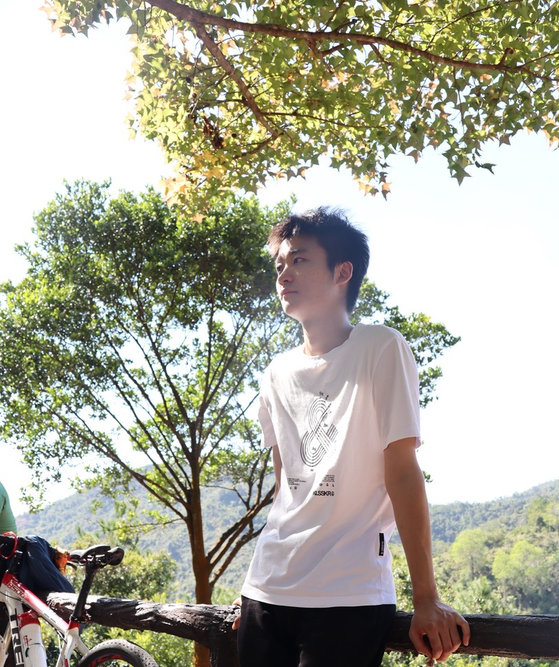

# Jeff Ge

**AI Specialist** · Hong Kong

[chloceg.github.io](https://chloceg.github.io) ·
[PDF CV](https://chloceg.github.io/files/Jeff-Ge-CV.pdf) ·
[njycgqw@icloud.com](mailto:njycgqw@icloud.com) ·
[GitHub](https://github.com/chloceg) ·
[+852 5335 2638](tel:+85253352638)

TenderAI in production · 80+ colleagues on it daily · HKMA / HKPF / AA / Deloitte programs

这是我的个人简历仓库。网页版：[chloceg.github.io](https://chloceg.github.io) ，PDF：[Download CV](https://chloceg.github.io/files/Jeff-Ge-CV.pdf)。

## About Me

- AI Specialist with 3+ years shipping production LLM/GraphRAG systems. Sole owner of TenderAI, a multi-tenant tender platform (LlamaIndex + Neo4j + FastAPI) used daily by 80+ colleagues.

## Experience

### Hong Kong Broadband Network
*AI Specialist · Nov 2025 – Present · Hong Kong*

- **TenderAI**: Sole owner of the in-house tender platform — GraphRAG on FastAPI, LlamaIndex and Neo4j, Vue3 on the front, PostgreSQL for service data. 80+ colleagues use it daily for proposal-weakness analysis, outline drafting, and a dashboard of tender success rates.
- **Retrieval pipeline**: Mix of vector search, graph hops and keyword matching, with page-level citations from multi-file evidence. Tenant filters on the shared Neo4j store keep neighbouring tenders from leaking; FastAPI streaming moves blocking LLM I/O off the event loop under concurrent use.
- **Presales**: First-line AI consult sitting with sales, 1,500+ SME customers at team scope. The actual job was deciding whether a vendor tool could be stood up locally, then telling management yes, no, or only with a local deploy.

### Hong Kong Applied Science and Technology Research Institute
*AI Engineer · Apr 2023 – Oct 2025 · Hong Kong*

- **HKMA network graph**: Community detection and node similarity on an HKMA programme. Built the financial-entity graph in Neo4j and the interactive view used when analysts looked at laundering, manipulation and fraud rings.
- **ChatDoc**: Focused on the Hong Kong Police Force and Airport Authority programmes. RAG core that can swap the underlying LLM, plus a backend feedback module that records how staff actually use the assistant.
- **ESG NER**: Trained UIE models for ESG initiative recognition and shipped an API so Deloitte users can pull targets from annual reports. Backend for the reasoning system sitting on that API.
- **Campaign backgrounds**: Explored image generation with Stable Diffusion, ComfyUI, ControlNet and LoRA. Batch pipelines for custom backgrounds so campaigns did not have to lean on stock photography.

### Bank of China Financial Technology Co., Ltd.
*Risk Modeling Intern · Jul 2022 – Sep 2022 · Shanghai*

- **IP valuation**: Sourced and cleaned public and vendor data on intellectual-property valuation, then trained LightGBM models that bucket rights into high, mid and low net-worth tiers for risk pricing.

## Projects

### HUAWEI CTF Security Competition
*Core Team Member · Jul 2022 – Aug 2022*

- Constructed a discrete elliptic-curve Abel group over a finite field using modular arithmetic. Recovered RSA primes p and q, computed Euler's totient, and derived the private exponent d to obtain the FLAG.

### Credit Suisse: CodeIT Competition
*Core Team Member · Sep 2022 – Oct 2022*

- Programming hackathon in English with teammates on GitHub; placed 7th of 24 university teams.

## Skills

- **Languages & backend**: Python, FastAPI, SQL, Linux, Git
- **LLM & retrieval**: LlamaIndex, RAG / GraphRAG, vLLM, MCP, PyTorch
- **Data & graphs**: Neo4j, PostgreSQL, Milvus, Pandas, LightGBM
- **Image generation**: ComfyUI, Stable Diffusion, ControlNet, LoRA
- **Deployment**: Docker, Exposure: Kubernetes

## Education

### The Hong Kong Polytechnic University
*M.Sc. in Data Science and Analytics · Sep 2021 – Mar 2023 · Hong Kong*
- Related courses: Optimization Methods, Principles of Data Science, Statistical Data Mining, Big Data Computing, Advanced High Dimensional Data Analysis, Deep Learning.

### Hohai University (Project 211)
*B.Sc. in Information and Computing Science · Sep 2017 – Jun 2021 · Nanjing, China*
- Related courses: C++, Data Structure, Machine Learning, Stochastic Process, Multivariate Statistics, Probability, Mathematical Modeling, PDE, ODE, Numerical Analysis, Optimization Algorithm.

## Awards

- **Credit Suisse: CodeIT Competition** — 7th of 24 university teams (Oct 2022)
- **HUAWEI CTF Security Competition** — Core Team Member (Aug 2022)

## Contact

- **Email**: [njycgqw@icloud.com](mailto:njycgqw@icloud.com)
- **Phone**: [+852 5335 2638](tel:+85253352638)
- **GitHub**: [github.com/chloceg](https://github.com/chloceg)
- **Website**: [chloceg.github.io](https://chloceg.github.io)
- **CV (PDF)**: [Download CV](https://chloceg.github.io/files/Jeff-Ge-CV.pdf)

---

*Last updated 2026-11-11 (Asia/Shanghai). © 2026 Jeff Ge.*

How this resume repo is maintained

Content lives in <code>_data/cv.yml</code>. After editing it, run:

<pre>python3 scripts/render_readme.py</pre>

That regenerates this README. The GitHub Pages site at https://chloceg.github.io reads the same YAML through Jekyll (<code>_pages/about.md</code>). Preview locally with <code>./run_server.sh</code>.

